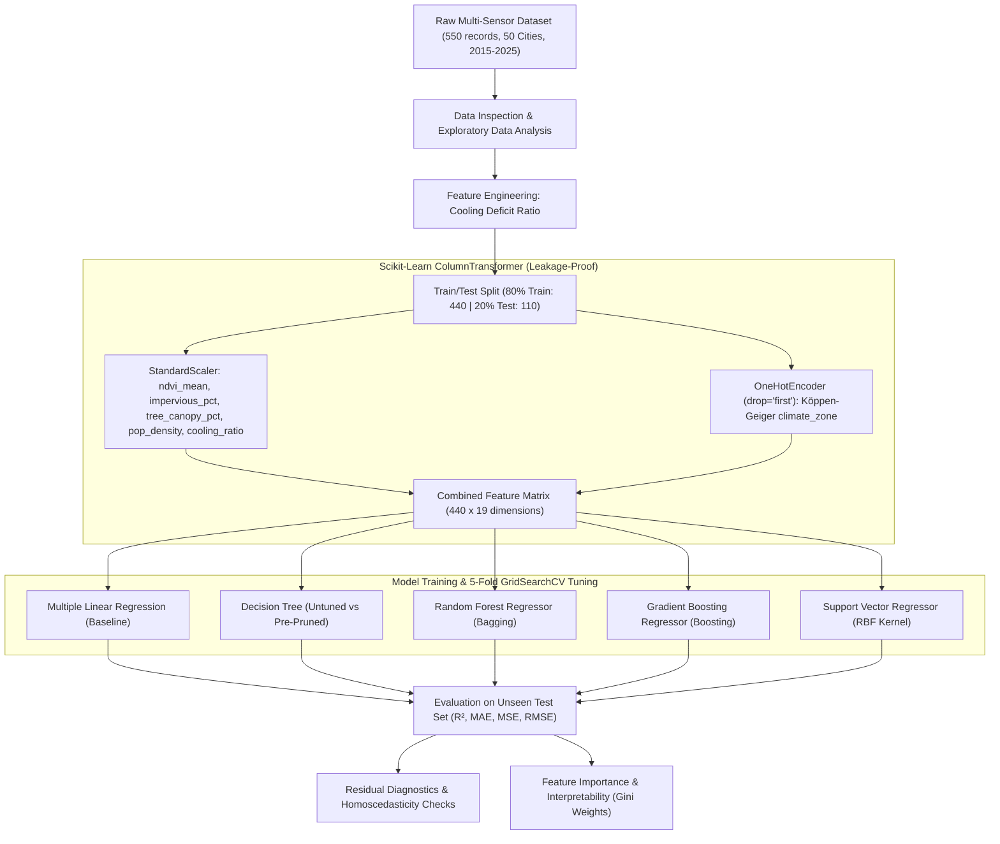

# 🌍 Urban Heat Island Prediction and Environmental Assessment

[](https://www.python.org/)
[](Urban_Heat_Island_Prediction_and_Environmental_Assessment.ipynb)
[](https://scikit-learn.org/)
[](https://colab.research.google.com/github/rohitranjankumar-01/Urban-Heat-Island-Prediction-and-Environmental-Assessment/blob/main/Urban_Heat_Island_Prediction_and_Environmental_Assessment.ipynb)
[](https://nbviewer.org/github/rohitranjankumar-01/Urban-Heat-Island-Prediction-and-Environmental-Assessment/blob/main/Urban_Heat_Island_Prediction_and_Environmental_Assessment.ipynb)
[](LICENSE)

> **Supervised Machine Learning regression framework for modeling, predicting, and diagnosing Land Surface Temperature Anomalies (LST in °C above city baseline) across 50 global megacities (2015–2025) using multi-sensor remote sensing, climate classification, and land-cover feature engineering.**

---

## 📌 Interactive Notebook Hub

Explore, inspect, and run the complete analytical notebook with all generated plots and models:

| Platform | Quick Link | Purpose |
| :--- | :--- | :--- |
| **Google Colab** | [](https://colab.research.google.com/github/rohitranjankumar-01/Urban-Heat-Island-Prediction-and-Environmental-Assessment/blob/main/Urban_Heat_Island_Prediction_and_Environmental_Assessment.ipynb) | One-click interactive execution in the cloud |
| **nbviewer** | [](https://nbviewer.org/github/rohitranjankumar-01/Urban-Heat-Island-Prediction-and-Environmental-Assessment/blob/main/Urban_Heat_Island_Prediction_and_Environmental_Assessment.ipynb) | Fast, rich web rendering of notebook outputs and figures |
| **GitHub Repository** | [](Urban_Heat_Island_Prediction_and_Environmental_Assessment.ipynb) | Direct link to view the `.ipynb` file in this repository |
| **Kaggle Dataset** | [](https://www.kaggle.com/datasets/alitaqishah/global-urban-heat-intensity-dataset-20152025) | Multi-source remote sensing data (2015–2025) |

---

## 📖 Table of Contents

- [Executive Summary](#-executive-summary)
- [Key Results & Model Benchmark](#-key-results--model-benchmark)
- [System Architecture & ML Pipeline](#-system-architecture--ml-pipeline)
- [Dataset Architecture & Feature Engineering](#-dataset-architecture--feature-engineering)
- [Exploratory Data Analysis (EDA) Insights](#-exploratory-data-analysis-eda-insights)
- [Model Exploration & Bias-Variance Diagnosis](#-model-exploration--bias-variance-diagnosis)
- [Residual Analysis & Error Diagnostics](#-residual-analysis--error-diagnostics)
- [Feature Importance & Model Interpretability](#-feature-importance--model-interpretability)
- [License & Citation](#-license--citation)

---

## 🔬 Executive Summary

Urban Heat Islands (UHIs) represent one of the most critical microclimatic challenges of 21st-century urbanization. High concentrations of impermeable concrete, low-albedo asphalt, dense high-rise architecture, reduced evapotranspiration from vegetative canopies, and anthropogenic waste heat combine to elevate urban surface temperatures significantly above surrounding rural baselines.

This project delivers an end-to-end, scientifically validated machine learning workflow designed to:
1. **Model Land Surface Temperature Anomalies (`lst_anomaly_c`)** across 550 observations spanning 50 global megacities over an 11-year observation window (2015–2025).
2. **Benchmark 5 Regressor Architectures**: Multiple Linear Regression (Baseline), Decision Tree Regressor (with Pre-Pruning), Random Forest Regressor (Bagging Ensemble), Gradient Boosting Regressor (Boosting Ensemble), and Support Vector Regressor (SVR with RBF Kernel).
3. **Address Multicollinearity & Data Leakage**: Employ strict train-only `ColumnTransformer` preprocessing pipelines incorporating `StandardScaler` and `OneHotEncoder`.
4. **Engineer Domain-Specific Microclimatic Indicators**: Formulate the **Cooling Deficit Ratio** (`impervious_pct` / `tree_canopy_pct`) to quantify thermal imbalance between built surfaces and vegetative shading.

---

## 🏆 Key Results & Model Benchmark

All models were evaluated on an unseen, held-out test set ($N=110$, 20% split) using 5-fold cross-validation during hyperparameter optimization.

| Rank | Model Architecture | Strategy | Test R² Score | Test MAE (°C) | Test MSE (°C²) | Test RMSE (°C) | Bias-Variance Status |
| :---: | :--- | :--- | :---: | :---: | :---: | :---: | :---: |
| 🥇 | **Support Vector Regressor (SVR)** | **RBF Kernel ($C=50, \epsilon=0.1, \gamma=\text{scale}$)** | **0.8463** | **0.1420** | **0.0326** | **0.1806** | **Optimal Generalization** |
| 🥈 | **Random Forest Regressor** | Bagging Ensemble ($n=100, \text{depth}=10, \text{split}=5$) | **0.8324** | **0.1468** | **0.0356** | **0.1886** | Low Variance / High Stability |
| 🥉 | **Gradient Boosting Regressor** | Boosting Ensemble ($n=100, \text{lr}=0.05, \text{depth}=4$) | **0.8169** | **0.1539** | **0.0389** | **0.1972** | Well-Regularized |
| 4 | **Decision Tree Regressor (Tuned)** | Pre-Pruned Tree ($\text{depth}=5, \text{leaf}=4, \text{split}=10$) | **0.8150** | **0.1579** | **0.0393** | **0.1981** | Variance Eliminated |
| 5 | **Multiple Linear Regression** | Ordinary Least Squares Baseline | **0.5809** | **0.2359** | **0.0889** | **0.2982** | Severe Underfitting |

### Core Algorithmic Takeaways:
* **The Continuous Manifold Advantage**: SVR with an RBF kernel outperforms tree ensembles because physical surface temperature anomalies follow continuous thermodynamic gradients rather than rigid axis-aligned orthogonal partitions.
* **Overfitting Mitigation**: Unconstrained Decision Trees achieved a deceptive $R^2 = 1.000$ on training data but dropped to $0.7483$ on test data ($+0.2517$ gap). Pre-pruning successfully reduced the overfitting gap by over 60% while raising test $R^2$ to $0.8150$.
* **Predictive Precision**: The top SVR model predicts surface temperature anomalies within an average absolute error of **±0.142 °C**.

---

## 🛠 System Architecture & ML Pipeline

The project follows a modular, leakage-proof machine learning workflow:



---

## 📊 Dataset Architecture & Feature Engineering

### 1. Feature Dictionary

The dataset (`global_urban_heat_island_2015_2025.csv`) tracks multi-year satellite and demographic measurements across 50 international urban centers:

| Feature Name | Type | Physical Dimension / Unit | Statistical Summary (Mean ± Std) | Description |
| :--- | :--- | :--- | :--- | :--- |
| `lst_anomaly_c` **[Target]** | Float | Celsius (°C) | 3.021 ± 0.472 (Min: 1.83, Max: 4.54) | Land Surface Temperature anomaly above regional rural baseline |
| `ndvi_mean` | Float | Ratio [0, 1] | 0.179 ± 0.064 (Min: 0.028, Max: 0.356) | Mean Normalized Difference Vegetation Index (vegetative density) |
| `impervious_pct` | Float | Percentage 0% – 100% | 66.48 ± 7.80% (Min: 45%, Max: 88%) | Proportion of built concrete, asphalt, and non-evaporating surfaces |
| `tree_canopy_pct` | Float | Percentage 0% – 100% | 14.84 ± 7.82% (Min: 2%, Max: 36%) | Percentage of land area shaded by mature urban tree canopies |
| `pop_density_km2` | Float | Persons / km² | 7120.7 ± 5278.4 (Skewness: +3.39) | Urban population concentration per square kilometer |
| `cooling_deficit_ratio` | Float | Ratio | 6.23 ± 4.12 **[Engineered]** | Ratio of thermal concrete mass to vegetative canopy cover |
| `climate_zone` | Categorical | Köppen Code | 15 Global Climate Regimes | Köppen-Geiger regional macro-climate regime |
| `heat_mortality_per_100k` | Float | Deaths / 100k | 2.31 ± 1.14 | Annual heat-related mortality rate per 100,000 population |

### 2. Domain Feature Engineering: Cooling Deficit Ratio
Physical urban heat intensity is governed by the structural balance between heat-trapping thermal mass and vegetative evapotranspirative cooling:

$$\text{Cooling Deficit Ratio} = \frac{\text{Impervious Surface Cover (\%)}}{\text{Tree Canopy Cover (\%)} + 10^{-4}}$$

```python
# Feature formulation in notebook
df['cooling_deficit_ratio'] = df['impervious_pct'] / (df['tree_canopy_pct'] + 1e-4)
```

A high ratio highlights severe microclimatic heat vulnerability where built infrastructure overwhelms local vegetative cover. This single engineered feature captures **~9.96%** of total split importance in ensemble models.

### 3. Köppen-Geiger Climate Classification Regimes
The dataset covers 15 distinct global climate zones to capture regional macro-climate baseline conditions:
- **Tropical (`Af`, `Aw`)**: High year-round ambient temperatures and elevated nighttime humidity.
- **Arid & Semi-Arid (`BWh`, `BWn`, `BSh`, `BSk`)**: High solar irradiance and strong diurnal swings with low precipitation.
- **Temperate (`Csa`, `Csb`, `Cfa`, `Cfb`, `Cwa`, `Cwb`)**: Mediterranean and humid subtropical urban areas.
- **Continental (`Dfa`, `Dfb`, `Dwa`)**: Strong seasonal temperature amplitudes with hot summer peaks.

---

## 📈 Exploratory Data Analysis (EDA) Insights

Key empirical findings from exploratory analysis in the notebook:
* **Target Distribution**: `lst_anomaly_c` exhibits a near-normal Gaussian distribution centered at **3.02 °C** (skewness = -0.09), confirming that continuous mean-squared error loss is well-suited without non-linear target transformations.
* **Primary Linear Driver**: Built-up concrete cover (`impervious_pct`) exhibits the highest positive linear correlation ($r \approx +0.35$) with surface temperature anomalies, adding ~0.021 °C per 1% increase in impervious surface.
* **Non-Linear Vegetative Effects**: Raw vegetative metrics (`tree_canopy_pct`, `ndvi_mean`) exhibit weak linear Pearson correlations, indicating that microclimatic cooling involves non-linear saturation thresholds and climate-zone-dependent interactions.
* **Severe Feature Skewness**: Population density (`pop_density_km2`) has strong positive skewness (+3.39), highlighting the necessity of `StandardScaler` normalization prior to distance- and margin-based modeling.

> 🔗 **Interactive Inspection**: [View Exploratory Data Analysis & Plots in Notebook](Urban_Heat_Island_Prediction_and_Environmental_Assessment.ipynb#3.-Dataset-Inspection)

---

## ⚙ Model Exploration & Bias-Variance Diagnosis

### Decision Tree Pruning & Regularization
To evaluate model complexity and prevent overfitting, default unconstrained decision trees were compared against 5-fold cross-validated pruned trees:

| Decision Tree Configuration | Train R² | Test R² | Train RMSE (°C) | Test RMSE (°C) | Overfitting Diagnosis |
| :--- | :---: | :---: | :---: | :---: | :--- |
| **Default / Unconstrained** (`depth=None`) | 1.0000 | 0.7483 | 0.0000 | 0.2314 | Severe Overfitting (High Variance) |
| **GridSearch Tuned** (`depth=5, leaf=4, split=10`) | 0.9133 | 0.8150 | 0.1378 | 0.1981 | Well-Regularized (Optimal Generalization) |

* **Generalization Gap**: Unconstrained trees memorize training sample noise, producing a wide generalization gap (0.2517). Restricting maximum depth and enforcing minimum samples per leaf eliminated high variance and lifted test $R^2$ from 0.7483 to **0.8150**.

> 🔗 **Interactive Inspection**: [View Decision Tree Pruning Curves in Notebook](Urban_Heat_Island_Prediction_and_Environmental_Assessment.ipynb#5.2-Model-2:-Decision-Tree-Regressor-&-Pruning-Analysis)

---

## 🎯 Residual Analysis & Error Diagnostics

### Error Distribution & Model Assumptions
The top-performing Support Vector Regressor (SVR with RBF kernel) was audited across its prediction residuals ($\epsilon = y - \hat{y}$):
* **Zero-Mean Unbiasedness**: Residuals have a mean of **0.0016 °C**, demonstrating that model predictions are strictly centered without systematic overestimation or underestimation.
* **Normal Distribution of Errors**: Residual errors exhibit a symmetrical bell-shaped distribution with a standard deviation of **0.1806 °C**.
* **Homoscedasticity**: Error variance remains uniform across the full range of predicted temperatures ($1.8^\circ\text{C}$ to $4.5^\circ\text{C}$), confirming that error variance is independent of anomaly magnitude.

> 🔗 **Interactive Inspection**: [View Residual Plots & Scatter in Notebook](Urban_Heat_Island_Prediction_and_Environmental_Assessment.ipynb#5.6-Model-Comparison-&-Evaluation-Summary)

---

## 🧠 Feature Importance & Model Interpretability

Feature importance weights extracted from the Random Forest ensemble reveal the dominant drivers of global urban heat intensity:

| Feature | Gini Importance Weight | Relative Contribution | Physical / Environmental Role |
| :--- | :---: | :---: | :--- |
| `impervious_pct` | **0.3057** | **30.57%** | Primary driver: heat absorption in concrete/asphalt infrastructure |
| `pop_density_km2` | **0.2111** | **21.11%** | Anthropogenic emission: vehicle exhaust, HVAC waste heat, urban canyons |
| `climate_zone_Cfa` | **0.1313** | **13.13%** | Macroclimatic factor: humid subtropical baseline amplification |
| `ndvi_mean` | **0.1022** | **10.22%** | Evapotranspirative vegetative cooling capacity |
| `cooling_deficit_ratio` | **0.0996** | **9.96%** | **Engineered feature**: Concrete-to-canopy structural imbalance |
| `climate_zone_BWn` | **0.0630** | **6.30%** | Coastal desert marine boundary inversion layer |
| `climate_zone_Aw` | **0.0395** | **3.95%** | Tropical savanna wet/dry seasonal regime |
| `tree_canopy_pct` | **0.0278** | **2.78%** | Direct shaded solar irradiance attenuation |

### Key Interpretability Insights:
* **Infrastructure & Anthropogenic Density**: Built surface percentage and population density jointly account for **over 51%** of predictive power.
* **Domain Feature Efficacy**: The engineered `cooling_deficit_ratio` ranks among the top 5 predictors (~10% relative importance), confirming that the concrete-to-vegetation ratio captures vital non-linear interaction signal beyond raw individual features.
* **Regional Baseline Adjustments**: Macro-climate indicators (such as `Cfa` humid subtropical and `BWn` coastal desert) supply important regional offsets that adjust baseline thermal expectations.

> 🔗 **Interactive Inspection**: [View Feature Importance Code & Chart in Notebook](Urban_Heat_Island_Prediction_and_Environmental_Assessment.ipynb#5.7-Model-Interpretability:-Feature-Importance-Analysis)

---

## 📄 License & Citation

### License
This project is licensed under the [MIT License](LICENSE).

### Author
**Rohit Ranjan Kumar**  
GitHub: [@rohitranjankumar-01](https://github.com/rohitranjankumar-01)  
Repository: [Urban-Heat-Island-Prediction-and-Environmental-Assessment](https://github.com/rohitranjankumar-01/Urban-Heat-Island-Prediction-and-Environmental-Assessment)

### Citation & Attribution
If you utilize this workflow or dataset in research or academic work, please cite:
```bibtex
@misc{kumar2026urbanheatisland,
  author = {Rohit Ranjan Kumar},
  title = {Urban Heat Island Prediction and Environmental Assessment: Multi-Sensor Machine Learning Modeling and Macro-Climate Analysis},
  year = {2026},
  publisher = {GitHub},
  howpublished = {\url{https://github.com/rohitranjankumar-01/Urban-Heat-Island-Prediction-and-Environmental-Assessment}}
}
```

---
<p align="center">
  <b>Built for Climate Resilience, Remote Sensing, and Urban Data Science 🌿🌡️🏙️</b>
</p>
