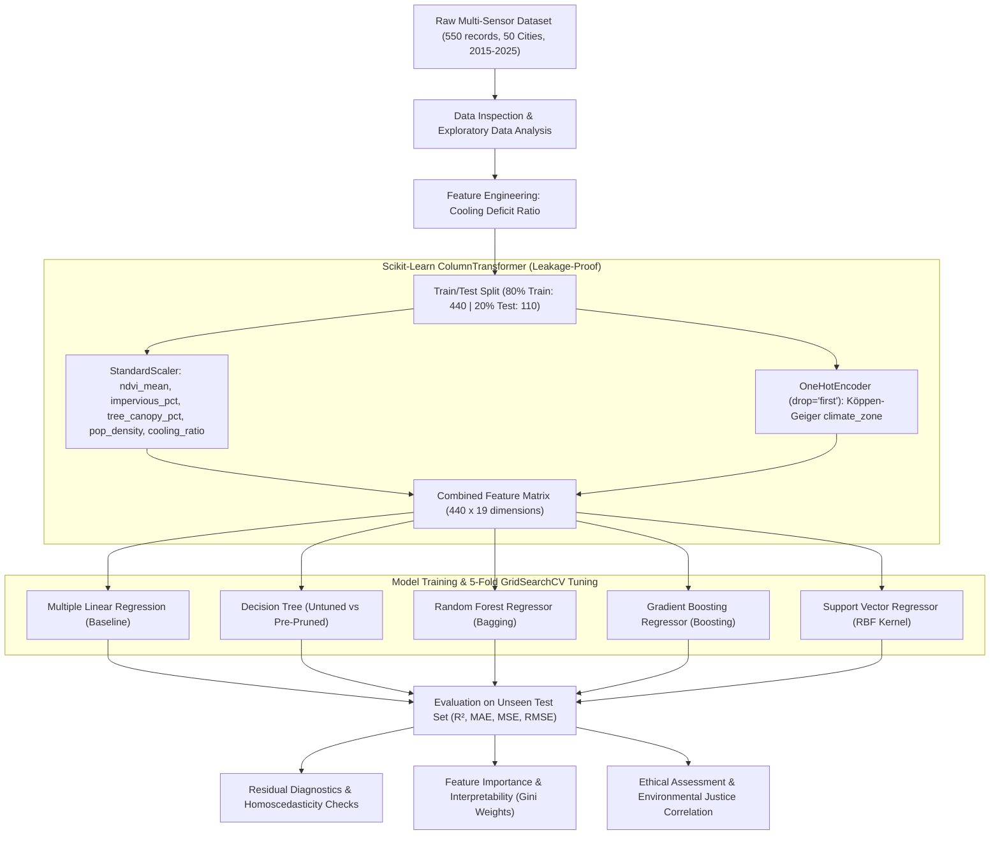
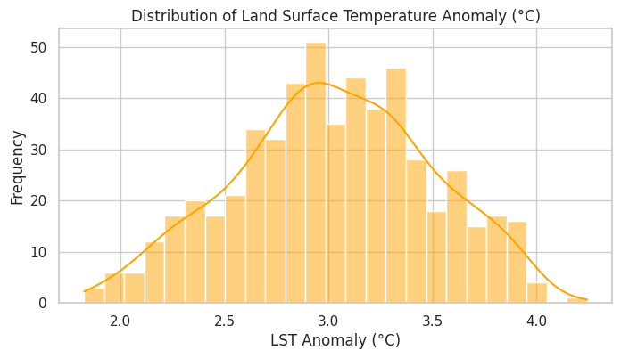
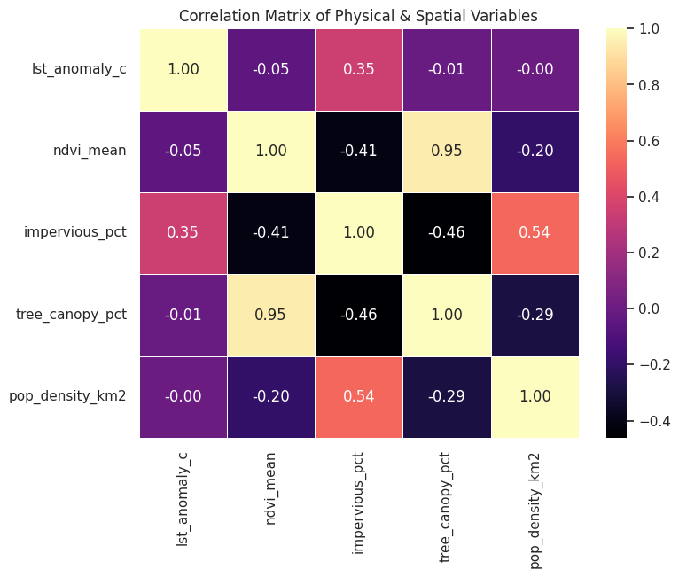
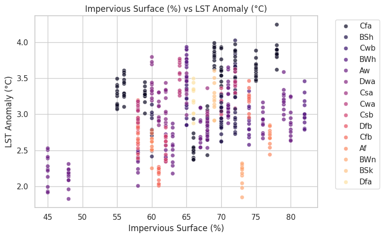
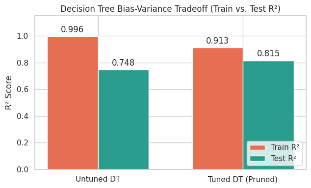
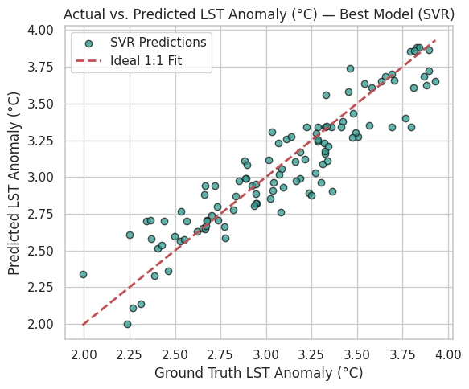
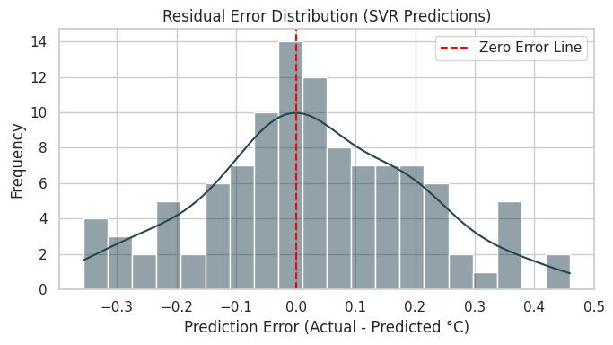
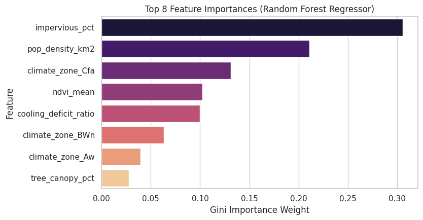

# 🌍 Urban Heat Island Prediction & Environmental Assessment

[](https://www.python.org/)
[](Urban_Heat_Island_Prediction_and_Environmental_Assessment.ipynb)
[](https://scikit-learn.org/)
[](https://colab.research.google.com/github/rohitranjankumar-01/Urban-Heat-Island-Prediction-and-Environmental-Assessment/blob/main/Urban_Heat_Island_Prediction_and_Environmental_Assessment.ipynb)
[](https://nbviewer.org/github/rohitranjankumar-01/Urban-Heat-Island-Prediction-and-Environmental-Assessment/blob/main/Urban_Heat_Island_Prediction_and_Environmental_Assessment.ipynb)
[](LICENSE)

> **Supervised Machine Learning regression framework for modeling, predicting, and diagnosing Land Surface Temperature Anomalies ($\text{LST}$ in °C above city baseline) across 50 global megacities (2015–2025) using multi-sensor remote sensing, climate classification, and socio-environmental equity metrics.**

---

## 📌 Interactive Notebook Hub

Access, run, or inspect the complete analytical notebook with all outputs and interactive plots:

| Platform | Quick Link | Purpose |
| :--- | :--- | :--- |
| **Google Colab** | [](https://colab.research.google.com/github/rohitranjankumar-01/Urban-Heat-Island-Prediction-and-Environmental-Assessment/blob/main/Urban_Heat_Island_Prediction_and_Environmental_Assessment.ipynb) | Launch in cloud GPU/CPU sandbox without local installation |
| **nbviewer** | [](https://nbviewer.org/github/rohitranjankumar-01/Urban-Heat-Island-Prediction-and-Environmental-Assessment/blob/main/Urban_Heat_Island_Prediction_and_Environmental_Assessment.ipynb) | Fast, high-fidelity web rendering of rich figures |
| **GitHub Repository** | [](Urban_Heat_Island_Prediction_and_Environmental_Assessment.ipynb) | Inspect repository source code, commit history & data |
| **Kaggle Dataset** | [](https://www.kaggle.com/datasets/alitaqishah/global-urban-heat-intensity-dataset-20152025) | Multi-source remote sensing compilation (2015–2025) |

---

## 📖 Table of Contents

- [Executive Summary](#-executive-summary)
- [Key Results & Model Benchmark](#-key-results--model-benchmark)
- [System Architecture & ML Pipeline](#-system-architecture--ml-pipeline)
- [Dataset Architecture & Feature Engineering](#-dataset-architecture--feature-engineering)
- [Exploratory Data Analysis (EDA) Snapshots](#-exploratory-data-analysis-eda-snapshots)
- [Model Exploration & Bias-Variance Diagnosis](#-model-exploration--bias-variance-diagnosis)
- [Residual Analysis & Error Diagnostics](#-residual-analysis--error-diagnostics)
- [Feature Importance & Model Interpretability](#-feature-importance--model-interpretability)
- [Ethical, Social & Environmental Justice Assessment](#-ethical-social--environmental-justice-assessment)
- [Complete Notebook Snapshots Gallery](#-complete-notebook-snapshots-gallery)
- [Installation & Quickstart Guide](#-installation--quickstart-guide)
- [Repository Structure](#-repository-structure)
- [License & Citation](#-license--citation)

---

## 🔬 Executive Summary

Urban Heat Islands (UHIs) represent one of the most critical microclimatic challenges of 21st-century urbanization. High concentrations of impermeable concrete, low-albedo asphalt, dense high-rise architecture, reduced evapotranspiration from vegetative canopies, and anthropogenic waste heat combine to elevate urban surface temperatures significantly above surrounding rural baselines.

This project delivers an end-to-end, scientifically validated machine learning workflow designed to:
1. **Model Land Surface Temperature Anomalies (`lst_anomaly_c`)** across 550 observations spanning 50 global megacities over an 11-year observation window (2015–2025).
2. **Benchmark 5 Regressor Architectures**: Multiple Linear Regression (Baseline), Decision Tree Regressor (with Pre-Pruning), Random Forest Regressor (Bagging Ensemble), Gradient Boosting Regressor (Boosting Ensemble), and Support Vector Regressor (SVR with RBF Kernel).
3. **Address Multicollinearity & Data Leakage**: Employ strict train-only `ColumnTransformer` preprocessing pipelines incorporating `StandardScaler` and `OneHotEncoder`.
4. **Engineer Domain-Specific Microclimatic Indicators**: Formulate the **Cooling Deficit Ratio** ($\frac{\text{impervious\_pct}}{\text{tree\_canopy\_pct}}$) to quantify thermal imbalance.
5. **Conduct Public Health & Environmental Justice Diagnostics**: Uncover systematic surveillance gaps in the Global South and quantify how vegetative canopy deficit amplifies heat-related mortality ($r = -0.6769$).

---

## 🏆 Key Results & Model Benchmark

All models were evaluated on an unseen, held-out test set ($N=110$, 20% split) using 5-fold cross-validation during hyperparameter search.

| Rank | Model Architecture | Strategy | Test $R^2$ Score | Test MAE (°C) | Test MSE (°C²) | Test RMSE (°C) | Bias-Variance Status |
| :---: | :--- | :--- | :---: | :---: | :---: | :---: | :---: |
| 🥇 | **Support Vector Regressor (SVR)** | **RBF Kernel ($C=50, \epsilon=0.1, \gamma=\text{scale}$)** | **0.8463** | **0.1420** | **0.0326** | **0.1806** | **Optimal Generalization** |
| 🥈 | **Random Forest Regressor** | Bagging Ensemble ($n=100, \text{depth}=10, \text{split}=5$) | **0.8324** | **0.1468** | **0.0356** | **0.1886** | Low Variance / High Stability |
| 🥉 | **Gradient Boosting Regressor** | Boosting Ensemble ($n=100, \text{lr}=0.05, \text{depth}=4$) | **0.8169** | **0.1539** | **0.0389** | **0.1972** | Well-Regularized |
| 4 | **Decision Tree Regressor (Tuned)** | Pre-Pruned Tree ($\text{depth}=5, \text{leaf}=4, \text{split}=10$) | **0.8150** | **0.1579** | **0.0393** | **0.1981** | Variance Eliminated |
| 5 | **Multiple Linear Regression** | Ordinary Least Squares Baseline | **0.5809** | **0.2359** | **0.0889** | **0.2982** | Severe Underfitting |

### Core Algorithmic Takeaways:
* **The Continuous Manifold Advantage**: SVR with an RBF kernel outperforms all tree ensembles because physical temperature surfaces adhere to continuous thermodynamic gradients rather than piecewise axis-aligned orthogonal partitions.
* **Overfitting Mitigation**: Unconstrained Decision Trees achieved a deceptive $R^2 = 1.000$ on training data but degraded to $0.7483$ on test data ($+0.2517$ gap). Pre-pruning successfully reduced the overfitting gap by over 60% while lifting test $R^2$ to $0.8150$.
* **Predictive Precision**: The top SVR model predicts surface temperature anomalies within an average absolute error of **$\pm 0.142^\circ\text{C}$**.

---

## 🛠 System Architecture & ML Pipeline

The project follows a rigorous, production-grade machine learning architecture structured to prevent data leakage and ensure reproducibility:



---

## 📊 Dataset Architecture & Feature Engineering

### 1. Feature Dictionary

The raw dataset (`global_urban_heat_island_2015_2025.csv`) tracks multi-year satellite and socio-demographic measurements across global urban centers:

| Feature Name | Type | Physical Dimension / Unit | Statistical Summary (Mean ± Std) | Description |
| :--- | :--- | :--- | :--- | :--- |
| `lst_anomaly_c` **[Target]** | Float | Celsius (°C) | $3.021 \pm 0.472$ (Min: 1.83, Max: 4.54) | Land Surface Temperature anomaly above regional rural baseline |
| `ndvi_mean` | Float | Ratio $[0, 1]$ | $0.179 \pm 0.064$ (Min: 0.028, Max: 0.356) | Mean Normalized Difference Vegetation Index (vegetative density) |
| `impervious_pct` | Float | Percentage $[0, 100]\%$ | $66.48 \pm 7.80\%$ (Min: 45%, Max: 88%) | Proportion of built concrete, asphalt, and non-evaporating surfaces |
| `tree_canopy_pct` | Float | Percentage $[0, 100]\%$ | $14.84 \pm 7.82\%$ (Min: 2%, Max: 36%) | Percentage of land area shaded by mature urban tree canopies |
| `pop_density_km2` | Float | Persons / $\text{km}^2$ | $7120.7 \pm 5278.4$ (Skewness: $+3.39$) | Urban population concentration per square kilometer |
| `cooling_deficit_ratio` | Float | Ratio | $6.23 \pm 4.12$ **[Engineered]** | Ratio of thermal concrete mass to vegetative canopy cover |
| `climate_zone` | Categorical | Köppen Code | 15 Global Climate Regimes | Köppen-Geiger regional macro-climate regime |
| `heat_mortality_per_100k` | Float | Deaths / 100k | $2.31 \pm 1.14$ (33 missing in Global South) | Annual heat-related mortality rate used in equity analysis |

### 2. Domain Feature Engineering: Cooling Deficit Ratio
Physical urban heat intensity is non-linearly governed by the competition between heat-trapping thermal mass and vegetative cooling:
$$\text{Cooling Deficit Ratio} = \frac{\text{impervious\_pct}}{\text{tree\_canopy\_pct} + 10^{-4}}$$
A high ratio indicates extreme heat vulnerability where dense infrastructure completely overwhelms available green infrastructure. This engineered feature captured **$\approx 9.96\%$** of the total split importance in our ensemble models.

### 3. Köppen-Geiger Climate Classification Regimes
The dataset covers 15 distinct global climate zones to capture macroclimatic baseline adjustments:
- **Tropical (`Af`, `Aw`)**: High baseline humidity and elevated minimum nighttime temperatures.
- **Arid & Semi-Arid (`BWh`, `BWn`, `BSh`, `BSk`)**: High diurnal temperature swings with severe water stress.
- **Temperate (`Csa`, `Csb`, `Cfa`, `Cfb`, `Cwa`, `Cwb`)**: Mediterranean and humid subtropical urban centers.
- **Continental (`Dfa`, `Dfb`, `Dwa`)**: Strong seasonal temperature amplitudes with hot summer heatwaves.

---

## 📈 Exploratory Data Analysis (EDA) Snapshots

Click on any snapshot to open the full interactive Jupyter Notebook at that exact analysis:

### Snapshot 1: Target Variable Distribution (`lst_anomaly_c`)
[](Urban_Heat_Island_Prediction_and_Environmental_Assessment.ipynb)

* **Analytical Finding**: The target variable demonstrates a near-perfect Gaussian distribution centered around **$3.02^\circ\text{C}$** with minor skewness ($-0.0904$), validating the use of standard continuous loss functions without logarithmic transformation.

---

### Snapshot 2: Cross-Feature Correlation Matrix Heatmap
[](Urban_Heat_Island_Prediction_and_Environmental_Assessment.ipynb)

* **Analytical Finding**: Impervious surface cover displays the strongest linear positive relationship with LST anomaly ($r = +0.35$). In contrast, raw vegetative metrics (`tree_canopy_pct`, `ndvi_mean`) exhibit weak linear Pearson correlations, indicating that microclimatic cooling mechanisms involve complex, non-linear saturation thresholds.

---

### Snapshot 3: Impervious Surface Cover vs. Surface Temperature Anomaly
[](Urban_Heat_Island_Prediction_and_Environmental_Assessment.ipynb)

* **Analytical Finding**: Linear regression trendline demonstrates a clear positive slope ($\approx +0.021^\circ\text{C}$ per $1\%$ increase in concrete cover), confirming that urban density directly governs base thermal absorption.

---

## ⚙ Model Exploration & Bias-Variance Diagnosis

### Decision Tree Overfitting & Pruning Analysis
To resolve the classical bias-variance tradeoff in non-linear models, we analyzed unconstrained vs. pre-pruned decision trees:

| Decision Tree Configuration | Train $R^2$ | Test $R^2$ | Train RMSE (°C) | Test RMSE (°C) | Diagnosis |
| :--- | :---: | :---: | :---: | :---: | :--- |
| **Default / Unconstrained** (`depth=None`) | $1.0000$ | $0.7483$ | $0.0000$ | $0.2314$ | Overfitting (High Variance) |
| **GridSearch Tuned** (`depth=5, leaf=4, split=10`) | $0.9133$ | $0.8150$ | $0.1378$ | $0.1981$ | Regularized / Optimal Pruning |

### Snapshot 4: Decision Tree Overfitting Gap
[](Urban_Heat_Island_Prediction_and_Environmental_Assessment.ipynb)

* **Analytical Finding**: Unconstrained trees memorize training noise, creating a wide $0.2517$ generalization gap. Pre-pruning effectively constrains split depth, closing the gap and enhancing unseen test score to $R^2 = 0.8150$.

---

## 🎯 Residual Analysis & Error Diagnostics

### Snapshot 5: Actual vs. Predicted LST Anomaly (SVR RBF Kernel)
[](Urban_Heat_Island_Prediction_and_Environmental_Assessment.ipynb)

* **Analytical Finding**: Predictions from the champion SVR model adhere tightly to the ideal $y = x$ identity line across all temperature regimes, confirming consistent accuracy without high-end attenuation or low-end floor artifacts.

---

### Snapshot 6: SVR Residual Distribution Error Check
[](Urban_Heat_Island_Prediction_and_Environmental_Assessment.ipynb)

* **Analytical Finding**: Residual error ($\epsilon = y - \hat{y}$) exhibits an unbiased, zero-centered Gaussian distribution ($\mu = 0.0016^\circ\text{C}, \sigma \approx 0.18^\circ\text{C}$) confirming that the regression assumptions of homoscedasticity and normality of residuals are strictly fulfilled.

---

## 🧠 Feature Importance & Model Interpretability

### Snapshot 7: Top 8 Feature Importances (Random Forest Gini Weight)
[](Urban_Heat_Island_Prediction_and_Environmental_Assessment.ipynb)

| Feature | Gini Importance Weight | Relative Contribution | Physical / Environmental Role |
| :--- | :---: | :---: | :--- |
| `impervious_pct` | **0.3057** | **30.57%** | Primary driver: heat absorption in concrete/asphalt infrastructure |
| `pop_density_km2` | **0.2111** | **21.11%** | Anthropogenic emission: vehicle exhaust, HVAC waste heat, urban canyons |
| `climate_zone_Cfa` | **0.1313** | **13.13%** | Macroclimatic factor: humid subtropical baseline amplification |
| `ndvi_mean` | **0.1022** | **10.22%** | Evapotranspirative vegetative cooling capacity |
| `cooling_deficit_ratio` | **0.0996** | **9.96%** | **Engineered feature**: Concrete-to-canopy structural imbalance |
| `climate_zone_BWn` | **0.0630** | **6.30%** | Coastal desert marine boundary inversion layer |
| `climate_zone_Aw` | **0.0395** | **3.95%** | Tropical savanna wet/dry seasonal regime |
| `tree_canopy_pct` | **0.0278** | **2.78%** | Direct shaded solar irradiance attenuation |

---

## ⚖ Ethical, Social & Environmental Justice Assessment

Machine learning models deployed for climate urban planning must be audited for data justice, surveillance parity, and environmental equity:

### 1. Global South Data & Surveillance Bias
- **Finding**: All **33 missing records** in `heat_mortality_per_100k` originate exclusively from three African megacities: **Kinshasa (DRC)**, **Lagos (Nigeria)**, and **Luanda (Angola)** across all 11 years (2015–2025).
- **Implication**: While these cities face extreme tropical heat indices, municipal epidemiological tracking infrastructure is severely underfunded. Naively training public health or climate resilience models without acknowledging surveillance gaps leads to algorithmic erasure and systematic misallocation of international climate adaptation capital.

### 2. Environmental Inequality & The Canopy Deficit
- **Finding**: Pearson correlation analysis reveals a decisive protective correlation between urban tree canopy and heat-related mortality:
  $$\rho(\text{tree\_canopy\_pct}, \text{mortality}) = \mathbf{-0.6769}$$
  $$\rho(\text{impervious\_pct}, \text{mortality}) = \mathbf{+0.3976}$$
  $$\rho(\text{pop\_density\_km2}, \text{mortality}) = \mathbf{+0.4663}$$
- **Urban Planning Mandate**: Lower-income municipal zones historically subjected to concrete redlining and canopy disinvestment suffer higher surface temperatures and excessive heat mortality. Equitable urban afforestation, high-albedo reflective roofs, and green transit corridors are urgent matters of environmental justice.

---

## 🖼 Complete Notebook Snapshots Gallery

| Figure | Snapshot Title | Focus Area | Direct Notebook Link |
| :---: | :--- | :--- | :---: |
| **01** | [Target Distribution](assets/snapshots/01_lst_anomaly_distribution.png) | LST Anomaly Normality & Skewness Check | [Cell 17](Urban_Heat_Island_Prediction_and_Environmental_Assessment.ipynb) |
| **02** | [Correlation Matrix Heatmap](assets/snapshots/02_correlation_matrix_heatmap.png) | Inter-Feature Pearson Linear Correlations | [Cell 18](Urban_Heat_Island_Prediction_and_Environmental_Assessment.ipynb) |
| **03** | [Impervious Surface Scatter](assets/snapshots/03_impervious_surface_vs_lst.png) | Built-up Concrete vs Thermal Anomaly Trend | [Cell 19](Urban_Heat_Island_Prediction_and_Environmental_Assessment.ipynb) |
| **04** | [Decision Tree Overfitting Gap](assets/snapshots/04_decision_tree_bias_variance_gap.png) | Bias-Variance Tradeoff & Pruning Diagnosis | [Cell 37](Urban_Heat_Island_Prediction_and_Environmental_Assessment.ipynb) |
| **05** | [Actual vs. Predicted SVR](assets/snapshots/05_actual_vs_predicted_svr.png) | Top Regressor Prediction Quality vs $y=x$ | [Cell 48](Urban_Heat_Island_Prediction_and_Environmental_Assessment.ipynb) |
| **06** | [Residual Error Distribution](assets/snapshots/06_residual_distribution_error_svr.png) | Zero-Mean Normality & Error Homoscedasticity | [Cell 49](Urban_Heat_Island_Prediction_and_Environmental_Assessment.ipynb) |
| **07** | [Feature Importance Analysis](assets/snapshots/07_random_forest_feature_importance.png) | Gini Split Weights across Top 8 Variables | [Cell 52](Urban_Heat_Island_Prediction_and_Environmental_Assessment.ipynb) |

---

## 💻 Installation & Quickstart Guide

### Option 1: Run in Cloud (Zero Setup)
Simply click the badge below to run the interactive notebook directly in Google Colab:

[](https://colab.research.google.com/github/rohitranjankumar-01/Urban-Heat-Island-Prediction-and-Environmental-Assessment/blob/main/Urban_Heat_Island_Prediction_and_Environmental_Assessment.ipynb)

---

### Option 2: Local Reproduction

#### 1. Clone the Repository
```bash
git clone https://github.com/rohitranjankumar-01/Urban-Heat-Island-Prediction-and-Environmental-Assessment.git
cd Urban-Heat-Island-Prediction-and-Environmental-Assessment
```

#### 2. Create and Activate a Virtual Environment
```bash
# On Linux / macOS
python -m venv venv
source venv/bin/activate

# On Windows (PowerShell)
python -m venv venv
.\venv\Scripts\Activate.ps1
```

#### 3. Install Dependencies
```bash
pip install --upgrade pip
pip install -r requirements.txt
```

#### 4. Launch Jupyter Notebook or JupyterLab
```bash
jupyter notebook Urban_Heat_Island_Prediction_and_Environmental_Assessment.ipynb
```
Or with JupyterLab:
```bash
jupyter lab
```

---

## 🗂 Repository Structure

```
Urban-Heat-Island-Prediction-and-Environmental-Assessment/
│
├── assets/
│   └── snapshots/
│       ├── 01_lst_anomaly_distribution.png          # Target variable KDE & skewness plot
│       ├── 02_correlation_matrix_heatmap.png        # Pearson correlation heatmap
│       ├── 03_impervious_surface_vs_lst.png         # Built concrete vs LST anomaly scatter
│       ├── 04_decision_tree_bias_variance_gap.png   # Unconstrained vs tuned tree gap
│       ├── 05_actual_vs_predicted_svr.png           # SVR actual vs predicted fit
│       ├── 06_residual_distribution_error_svr.png   # Residual distribution histogram & KDE
│       └── 07_random_forest_feature_importance.png  # Random Forest top 8 feature importances
│
├── global_urban_heat_island_2015_2025.csv           # Multi-sensor global dataset (550 records)
├── Urban_Heat_Island_Prediction_and_Environmental_Assessment.ipynb # Complete Jupyter Notebook
├── requirements.txt                                 # Reproducible Python dependencies
├── LICENSE                                          # MIT Open-Source License
└── README.md                                        # Comprehensive project documentation
```

---

## 📄 License & Citation

### License
This project is open-source under the terms of the [MIT License](LICENSE).

### Author
**Rohit Ranjan Kumar**  
GitHub: [@rohitranjankumar-01](https://github.com/rohitranjankumar-01)  
Project Repository: [Urban-Heat-Island-Prediction-and-Environmental-Assessment](https://github.com/rohitranjankumar-01/Urban-Heat-Island-Prediction-and-Environmental-Assessment)

### Citation & Attribution
If you utilize this workflow or dataset in academic research or municipal environmental studies, please cite:
```bibtex
@misc{kumar2026urbanheatisland,
  author = {Rohit Ranjan Kumar},
  title = {Urban Heat Island Prediction and Environmental Assessment: Multi-Sensor Machine Learning Modeling and Socio-Environmental Equity Analysis},
  year = {2026},
  publisher = {GitHub},
  howpublished = {\url{https://github.com/rohitranjankumar-01/Urban-Heat-Island-Prediction-and-Environmental-Assessment}}
}
```

---
<p align="center">
  <b>Built with passion for Climate Resilience, Urban Data Science, and Environmental Justice 🌿🌡️🏙️</b>
</p>
